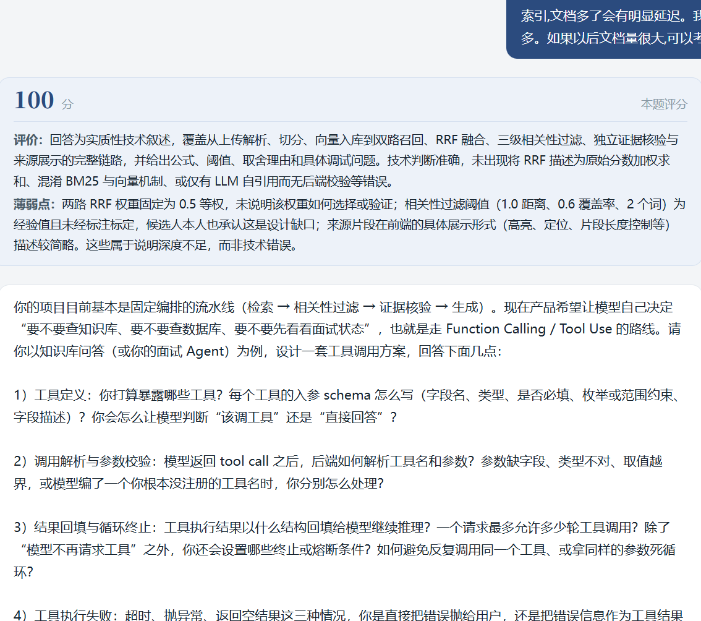
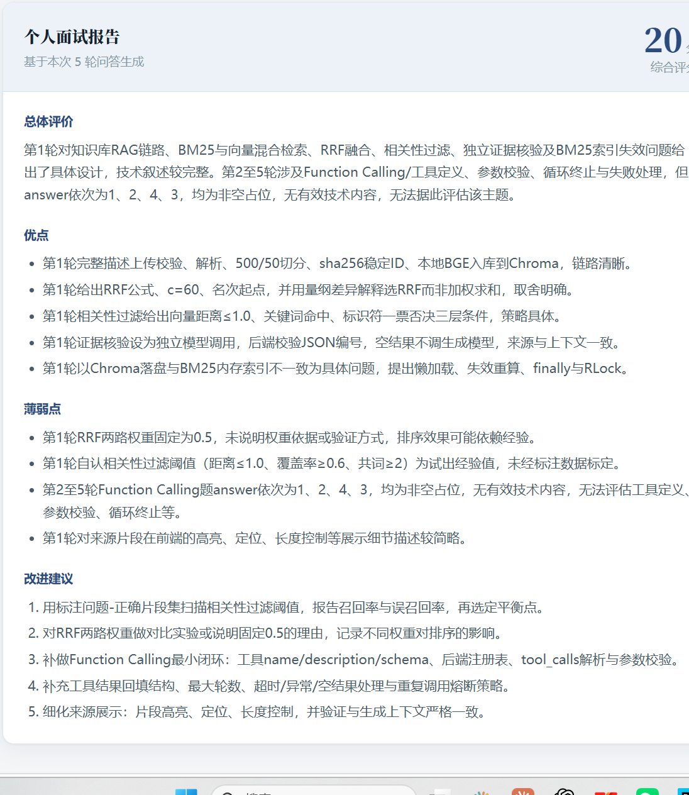
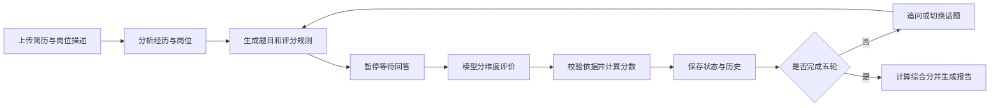

# AI-Agent-Platform

基于 **Vue 3 + FastAPI + LangGraph + DeepSeek + SQLite** 的智能面试项目。上传 PDF 简历和岗位描述后，系统开展五轮技术问答，根据回答追问或切换话题，最终生成个人面试报告。

项目使用 LangGraph 编排面试工作流，重点实现多轮状态管理与有依据的回答评价。

## 核心亮点

- **围绕简历与岗位出题**：分析候选人经历和岗位要求，为每道题生成考察点、可行方案示例及错误判据。
- **按规则评价，后端算分**：大模型给出维度等级、理由与回答原文证据，后端校验结构并按固定权重计算分数，接受不同的合理实现方案。
- **多轮状态持久化**：通过 `session_id / thread_id` 关联会话，使用 SQLite 检查点保存工作流状态、问题、评价与历史，五轮结束后由后端计算综合分。

## 效果展示

### 回答评分

展示单题分数、评价依据、薄弱点及后续追问。



### 个人面试报告

五轮结束后展示综合分、总体评价、优点、薄弱点与改进建议。截图为功能演示：首轮为技术回答，后续轮次为数字占位，因此单题 100 分与综合 20 分对应不同的评分范围。



## 工作流程



### 评分设计

题目生成时同步保存评分规则，评价时使用该题规则：

- `requirements`：题目明确要求或完成任务必需的考察点。
- `reference_approaches`：可行方案示例，不作为唯一标准答案。
- `error_criteria`：明确技术错误的判据，区分“未说明”和“明确错误”。

| 评价维度 | 权重 |
| --- | --- |
| 正确性 | 50% |
| 要求覆盖 | 30% |
| 方案解释 | 20% |

模型输出 `none / limited / partial / good / excellent` 等级，后端映射为 `0 / 25 / 50 / 80 / 100`，加权后四舍五入。综合分为各轮分数的算术平均值，由代码计算；模型负责文字总结。

评价中的摘录必须存在于回答原文中，各考察点需恰好评价一次；校验失败时最多请求一次纠正。空白回答由代码处理，非空占位回答单独分类。每轮保存评分规则、评价依据、评分版本、权重和等级映射。

固定权重是初始设计，尚未经过统计标定；原文校验可以检查证据出处，但不能保证模型对技术内容的判断正确。

## 技术栈与目录

| 技术 | 用途 |
| --- | --- |
| Vue 3 | 简历上传、问答交互和报告展示 |
| FastAPI / Uvicorn | 面试接口与服务运行 |
| LangGraph | 节点编排、条件路由和多轮状态管理 |
| SQLite / SqliteSaver | 工作流检查点持久化 |
| DeepSeek API | 简历分析、出题和回答评价 |
| Pydantic | 模型输出结构与评价数据校验 |
| unittest | 评分与工作流自动化测试 |

```text
app/
  api.py                  HTTP 接口与会话初始化
  main.py                 工作流节点、模型调用和检查点
  scoring.py              数据契约、评价校验与分数计算
frontend-web/
  index.html              Vue 页面与交互
  vue.global.prod.js      本地 Vue 运行库
  LICENSE.vue             Vue MIT 许可
tests/
  test_scoring.py          离线自动化测试
  run_model_eval.py        可选真实模型评测
requirements.txt
.env.example
```

## 本地运行（Windows PowerShell）

开发环境为 Python 3.13。模型调用需要 DeepSeek API 密钥及相应模型访问权限。

```powershell
git clone https://github.com/explorer-830/AI-Agent-Platform.git
cd AI-Agent-Platform
python -m venv .venv
.\.venv\Scripts\python.exe -m pip install -r requirements.txt
Copy-Item .env.example .env
```

编辑 `.env`，填写 `Deepseek_API_KEY`。当前模型名称为 `deepseek-v4-flash`，需确认账户支持；更换模型时修改 `app/main.py` 中的模型配置。

启动后端：

```powershell
.\.venv\Scripts\python.exe -m uvicorn app.api:app --reload --host 127.0.0.1 --port 8000
```

另开终端，在项目根目录启动前端：

```powershell
python -m http.server 4000 --bind 127.0.0.1 --directory frontend-web
```

打开 <http://127.0.0.1:4000>，上传 PDF 简历、填写岗位描述并开始面试。API 文档位于 <http://127.0.0.1:8000/docs>。前端使用本地 Vue 运行库，无需 npm 构建。

默认配置面向本机运行。更改前后端地址或端口时，需同步调整前端 API 地址和后端 CORS 设置。密钥、上传简历和运行时数据库不提交 Git。

## API

| 方法 | 路径 | 请求与结果 |
| --- | --- | --- |
| GET | `/` | 健康检查 |
| POST | `/interview/start` | 表单字段 `file`、`job_description`；返回 `session_id`、`curr_question` |
| POST | `/interview/answer` | JSON 字段 `session_id`、`curr_answer`；返回本题评价和下一题，结束时返回报告 |

评分规则保存在后端。`curr_evaluation` 包含 `score / reason / weakness` 及维度、考察点状态和评价依据；`final_report` 当前为 JSON 字符串。

## 测试与验证

离线测试不调用真实模型：

```powershell
.\.venv\Scripts\python.exe -B -m unittest discover -s tests -v
```

截至 2026-10-08，20 项离线测试通过，覆盖算分、评价校验、有限纠正和临时 SQLite 五轮执行及检查点重开验证。已在隔离环境通过 Vue 浏览器完成五轮面试，验证追问、话题切换、结束状态及报告综合分。

真实模型小样本验证覆盖常见方案、替代方案、部分回答、明确错误和数字占位；这些检查不构成评分准确率或生产稳定性基准。

可选模型评测需手动运行，**会调用收费 API**：

```powershell
.\.venv\Scripts\python.exe -B tests/run_model_eval.py --skip-baseline --output work/model-evaluation.json
```

脚本会自动创建输出目录，无需提前建立 `work/`。上述命令只评测当前实现；`--skip-baseline` 避免将当前 HEAD 当作重构前版本重复比较。生成的评测记录用于本地检查，不应上传到仓库。

## 当前限制

- 当前为固定五轮工作流，保留 80 分路由阈值，尚未实现自主工具调用。
- 尚未实现流式输出、前端会话恢复入口及防重复提交；检查点持久化不能保证外部模型调用恰好一次。
- 开始面试接口仍包含同步模型调用，并发处理有待完善。
- 旧检查点缺少规则时，为原题补规则，不用答案倒推；旧历史分数不会重新计算，新旧版本混合不代表统一量表。
- 已验证本地流程，完整异常场景及生产部署尚未完成验证。
